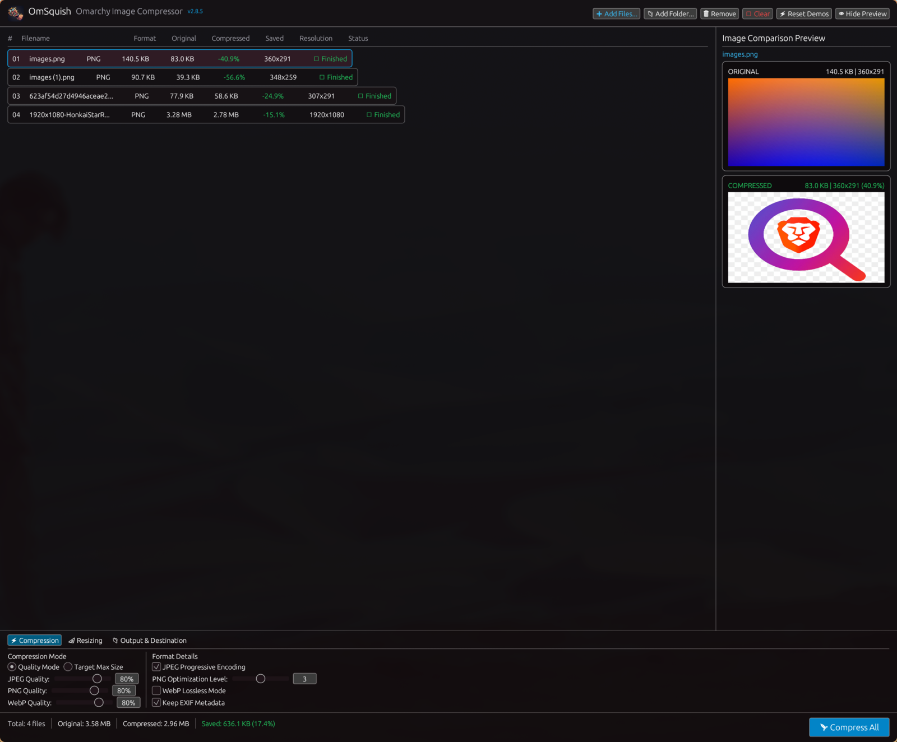
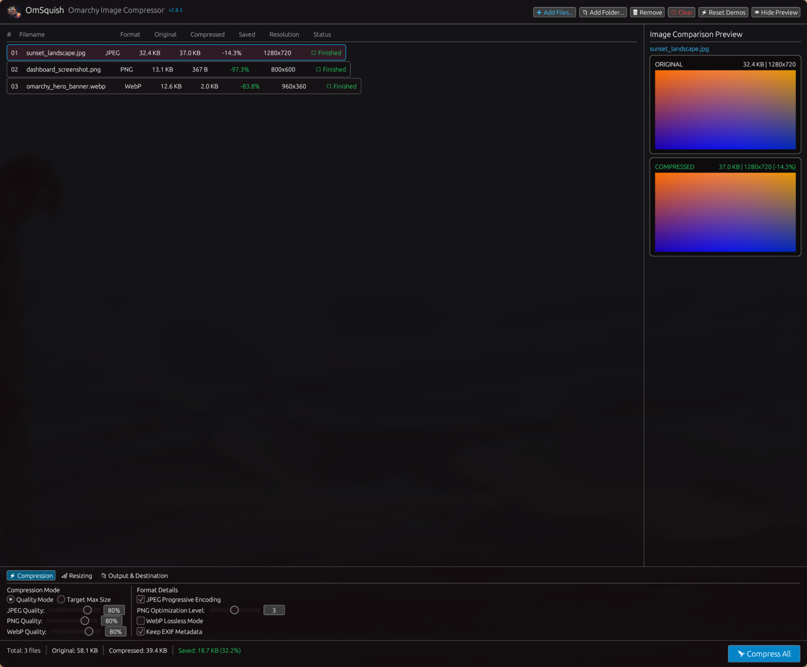
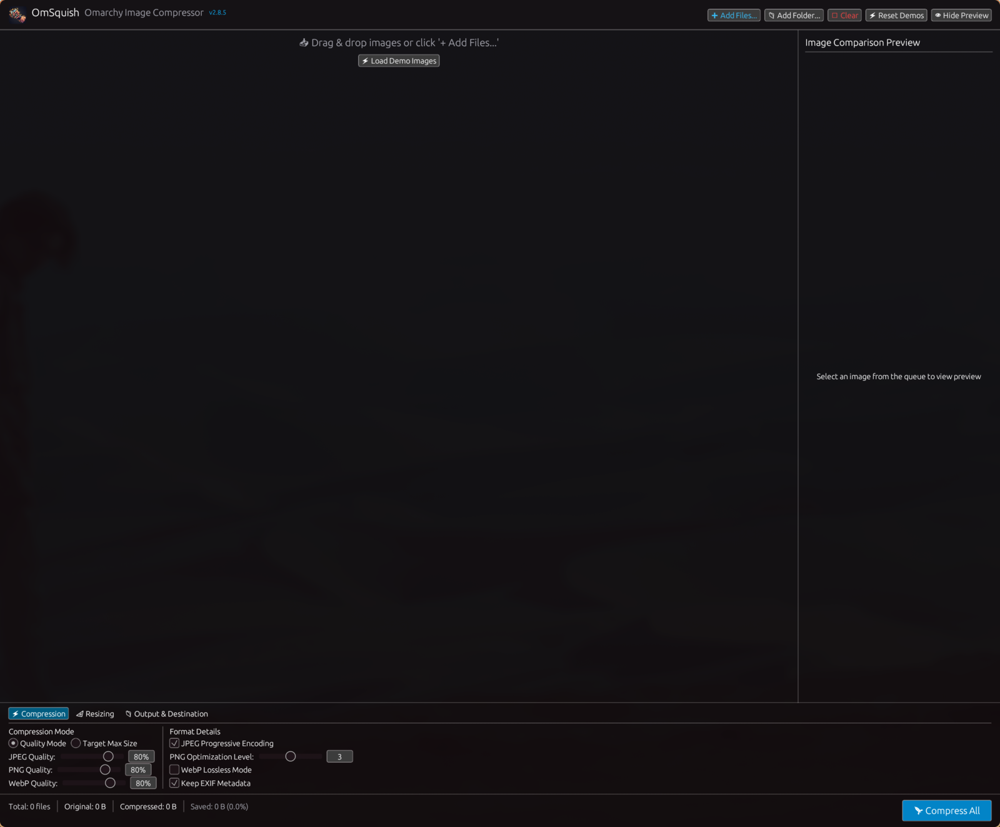
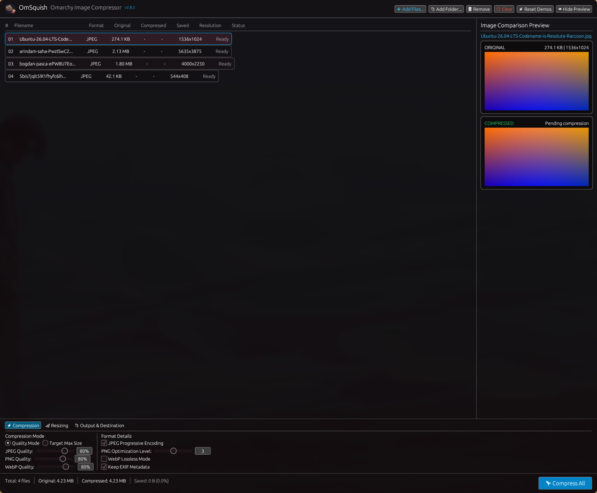
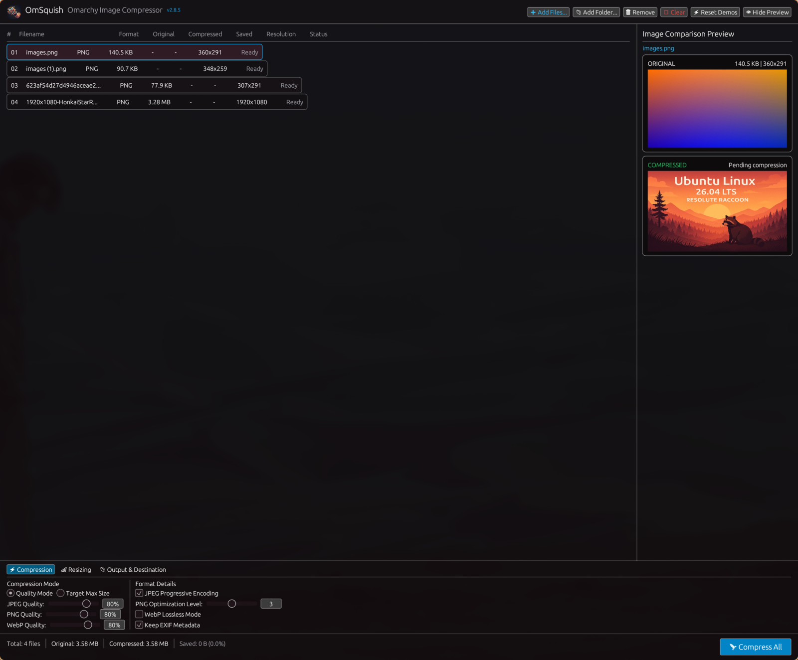

<div align="center">


# OmSquish

**Omarchy Image Compressor** — A fast, native Linux batch image compressor built with Rust and `egui`.

[](LICENSE)
[](https://www.rust-lang.org/)
[](#installation)

</div>

> [!IMPORTANT]
> **Project Status — Shared "As-Is" / Not Actively Maintained**
>
> OmSquish was built primarily for my personal workflow on **Omarchy Linux** and is **not an actively maintained project**. It is shared publicly **"as-is"** in the hope that it may be useful to others — you are welcome to use, modify, or fork it freely under the [MIT License](LICENSE), though issues and pull requests may not receive responses.

---

## Screenshots

### Batch Compression & Live Comparison Preview



### More Views

| Demo Queue & Built-in Samples | Empty Workspace & Drag-and-Drop |
| :---: | :---: |
|  |  |

| Queued JPEG Batch | Queued PNG Batch with Comparison Preview |
| :---: | :---: |
|  |  |

---

## Features

- **In-Process Batch Compression:** Compresses images natively in Rust with zero external CLI image tools required.
- **Two Compression Modes:**
  - **Quality Mode:** Independent quality sliders (1–100%) for JPEG, PNG, and WebP.
  - **Target Max Size:** Iterative quality search to fit compressed output within a target KB budget.
- **Format-Specific Controls:**
  - **JPEG:** Configurable quality encoding and progressive toggle.
  - **PNG:** Lossless optimization powered by [`oxipng`](https://github.com/shssoichiro/oxipng) (levels `0–6`) with optional metadata stripping.
  - **WebP:** Lossy and lossless encoding via `libwebp`.
  - **Smart Safeguard:** Option to automatically skip saving if the compressed output is larger than the original.
- **Batch Resizing:** Resize by **Dimensions (`W × H`)**, **Percentage (`%`)**, **Width**, or **Height** using Lanczos3 filtering, with *Keep Aspect Ratio* and *Do Not Enlarge* options.
- **Flexible Output & Conversion:**
  - Keep original format or batch-convert to **JPEG**, **PNG**, or **WebP**.
  - Save alongside originals with a custom filename suffix (default `_compressed`) or write to a custom destination folder.
- **Live Side-by-Side Preview:** Inspect original vs. compressed previews, dimensions, byte sizes, and percentage saved per file.
- **Wayland, Hyprland & Omarchy Ergonomics:**
  - Non-blocking native file & folder dialogs via `xdg-desktop-portal` (`rfd`) and off-thread image loading (`rayon`) to prevent compositor "Application Not Responding" prompts.
  - Universal drag-and-drop (`text/uri-list` and raw paths) with recursive folder scanning and automatic deduplication.
  - Translucent dark UI styling with Hyprland workspace visibility checks to skip unnecessary GPU repaints while hidden.
  - Built-in demo images (**Reset Demos** / **Load Demo Images**) for quick testing.

### Supported Formats

| Direction | Formats |
| :--- | :--- |
| **Queue / Drag-and-Drop Input** | JPEG (`.jpg`, `.jpeg`), PNG (`.png`), WebP (`.webp`) |
| **Output / Format Conversion** | Keep Original, JPEG, PNG, WebP |

---

## Dependencies

All image compression runs in-process via Rust crates (`eframe`/`egui`, `image`, `oxipng`, `webp`, `rfd`, `rayon`, `walkdir`).

### Arch Linux / Omarchy Linux

- **Build tools:** `rust`, `base-devel`, `pkgconf`, `cmake`, `clang`
- **Desktop & graphics libraries:** `gtk3`, `glib2`, `gdk-pixbuf2`, `pango`, `cairo`, `libxkbcommon`, `wayland`, `libglvnd`, `desktop-file-utils`, `hicolor-icon-theme`
- **Runtime portal (typically preinstalled on Omarchy):** `xdg-desktop-portal` with an active backend (e.g., `xdg-desktop-portal-hyprland` or `xdg-desktop-portal-gtk`)

### General Linux (Debian / Ubuntu / Fedora)

Install the Rust toolchain via [rustup](https://rustup.rs/) plus your distribution's development headers for GTK 3, Wayland, `libxkbcommon`, OpenGL/Mesa, `pkg-config`, `cmake`, and a C/C++ compiler:

```bash
# Debian / Ubuntu
sudo apt install build-essential pkg-config cmake clang libgtk-3-dev libxkbcommon-dev libwayland-dev libgl-dev

# Fedora
sudo dnf install gcc gcc-c++ pkgconf-pkg-config cmake clang gtk3-devel libxkbcommon-devel wayland-devel mesa-libGL-devel
```

---

## Installation

### Arch Linux / Omarchy Linux (Automated Installer)

Clone the repository and run the included installer script:

```bash
git clone https://github.com/techaeris/omsquish.git
cd omsquish
./install.sh
```

`install.sh` will:
1. Install any missing Arch build/runtime dependencies via `pacman --needed`.
2. Compile a native release binary with `cargo build --release --bin omsquish`.
3. Install the binary to `~/.local/bin/omsquish`.
4. Install hicolor PNG icons (`32×32` through `512×512`) to `~/.local/share/icons/hicolor/`.
5. Generate and install `~/.local/share/applications/omsquish.desktop` and refresh the desktop & icon caches.

> [!NOTE]
> Make sure `~/.local/bin` is in your `PATH` if you want to launch `omsquish` directly from a terminal. It will also appear automatically in your Omarchy / desktop app launcher as **OmSquish**.

### Manual Build (Any Linux Distribution)

```bash
git clone https://github.com/techaeris/omsquish.git
cd omsquish
cargo build --release --bin omsquish
./target/release/omsquish
```

To run the unit tests:

```bash
cargo test
```

---

## Credits & Inspiration

- Inspired by the clean batch workflow, sensible compression defaults, and user experience of **[Caesium Image Compressor](https://github.com/Lymphatus/caesium-image-compressor)** by Matteo Paonessa (`Lymphatus`). OmSquish is an independent, from-scratch Rust implementation built for Linux and Wayland/Hyprland desktops.
- Built on the shoulders of the Rust open-source ecosystem: [`eframe` / `egui`](https://github.com/emilk/egui), [`image`](https://github.com/image-rs/image), [`oxipng`](https://github.com/shssoichiro/oxipng), [`webp`](https://crates.io/crates/webp), [`rfd`](https://github.com/PolyMeilex/rfd), and [`rayon`](https://github.com/rayon-rs/rayon).

---

## License

This project is licensed under the **MIT License** — see the [LICENSE](LICENSE) file for details.
